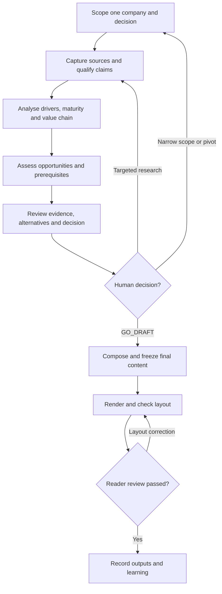

# Business Portfolio Analysis

**Turn fragmented company research into evidence-backed AI investment and transformation decisions.**

A public showcase of François Achard-Arnaud’s approach to **AI strategy, product design and operating models**: connect business drivers to operational opportunities, challenge the evidence, and carry the decision through to a controlled executive deliverable.

The repository combines a portfolio diagnostic method, structured knowledge, reusable agent instructions, Python validators and document renderers. **Hivest is the reference programme; the architecture separates company evidence from reusable methods and presentation code.**

> **Status:** working components within a human-led research prototype. The programme remains at `PILOTS` (Sphere and STG), with `production_allowed=false` in [program/state.json](program/state.json). Renderable examples demonstrate the method and presentation, not approved investment recommendations or measured business returns.

[See the example](#see-the-output) · [Understand the workflow](#how-the-workflow-works) · [Run a demo](#quick-start) · [Review the gaps](#what-is-still-missing)

## Why this project matters

An AI opportunity list is useful only when someone can explain **why the opportunity matters, what supports it, what could invalidate it, and who must decide next**. This project makes those questions explicit across a portfolio of companies.

| Business question | Project response | Where to inspect it |
| --- | --- | --- |
| Where could AI change the economics? | Market drivers → company exposure → value-chain activity → value mechanism; retain non-AI alternatives. | [Sphere business drivers](companies/sphere/analysis/03_drivers.md) and [use cases](companies/sphere/analysis/07_use_cases.md) |
| How credible is the diagnosis? | Sources, located fragments and typed claims, with contradictions, scope, cutoff dates and explicit unknowns. | [Sphere evidence](companies/sphere/evidence/coverage.md) and [bundle validator](scripts/validate_bundle.py) |
| What should be prioritised? | Assess maturity across eight dimensions and apply data rights, security/OT, human control, ownership and feasibility gates before ranking. | [Decision rules](contracts/decision-rules.md) |
| How does research become a decision? | Three review lenses, a pre-decision dossier, a recorded human decision and a versioned content freeze. | [Review procedure](skills/hivest-portfolio-ai/references/review.md) and [gates](docs/agent/gates.md) |
| Can another session continue the work? | Bounded context, pinned inputs, contradictory claims, stop conditions and a read-only resumption CLI. | [Context and resume](docs/agent/context-and-resume.md) |
| Can the result be communicated reliably? | Profile-specific payloads, HTML/PDF/PNG rendering, integrity checks and layout QA followed by human reading. | [Template registry](templates/registry.json) and [render evidence verifier](scripts/verify_render_evidence.py) |

**What this showcases:** translating a strategic question into a usable product workflow; designing the evidence and data contracts; defining human and agent responsibilities; and connecting quality controls to concrete outputs. The value lies in that complete chain, rather than in an isolated prompt or document generator. Business impact remains a hypothesis until a pilot establishes a baseline and measures the result.

## See the output

The three-page executive diagnostic moves from **business and market context**, to **value-chain opportunities**, to **transformation priorities and open questions**.

[Open the Sphere prototype PDF](companies/sphere/artifacts/SPHERE_diagnostic_prudent_3pages.pdf) · [Read its provenance and limitations](companies/sphere/artifacts/README.md)


*Historical French-language prototype, page 2 of 3. This committed example used a ReportLab fallback; it is not evidence that the current browser-based layout QA passed. Sphere remains in research, with source-archive and decision gates open.*

## How the workflow works

**Research can return to evidence; final composition requires a human decision.** This diagram summarises the documented workflow, not an autonomous execution service.



A substantive change after approval reopens the relevant evidence/review gate. Demonstration renders have a separate route and remain labelled as demonstrations; rendering does not grant release authority.

| Responsibility | Steps and handoff | Execution today |
| --- | --- | --- |
| **Extract** | Scope → source capture → fragment → claim → research questions. | Human/agent research; scripts check structure, references and available captured bytes. Raw archives stay outside public Git. |
| **Transform** | Market drivers → diagnostic → opportunities → three reviews → human decision. | Skill-guided reasoning, with explicit unknowns and non-AI options. Semantic review and approval remain human responsibilities. |
| **Publish** | Approved content → profile-specific payload → renderer → QA → reader review. | Executable renderers and verifiers; final release still requires the applicable human authority. |
| **Learn** | Defect → cause → proposed rule/contract/test → human promotion. | Documented loopback; portfolio-wide consolidation remains incomplete. |

Extract / Transform / Publish is a separation of responsibilities, not a claim of fully automated ETL. See the [seven-procedure workflow](skills/hivest-portfolio-ai/references/workflow.md) for exact inputs, outputs and return conditions.

## Architecture: evidence, method and build stay separate

| Layer | Canonical locations | Responsibility and boundary |
| --- | --- | --- |
| Programme and case state | [program/](program/state.json), `companies/<id>/manifest.json`, `INDEX.md` | Choose the entity, cutoff, active stage and next question. File presence never advances a gate automatically. |
| **Data and evidence** | `companies/<id>/package.json`, `evidence/`, `strategic_context.json`, `research_graph.json`; [wiki/](wiki/INDEX.md) | Company knowledge and its provenance. Shared sector knowledge is reusable context, not automatically a fact about a company. Restricted original bytes remain in an authorised external archive. |
| **Context management** | [RunContext schema](contracts/run-context.schema.json), [checkpoint schema](contracts/session-checkpoint.schema.json), [resumption CLI](scripts/session_checkpoint.py) | Pin versions and hashes; retain decisive claims, counterclaims, unknowns and stop conditions. Detect stale inputs instead of silently trusting a previous session. |
| **Skills and orchestration** | [AGENTS.md](AGENTS.md), [diagnostic skill](skills/hivest-portfolio-ai/SKILL.md), [handoff contract](docs/agent/handoff-and-fallback.md) | Route to one active procedure and its required references. A role can run in one session; a Markdown skill is not a deployed autonomous agent. |
| **Build and validation** | [contracts/](contracts/decision-rules.md), `scripts/`, [tests/](tests/README.md), `.github/workflows/` | Schemas, integrity checks, negative tests and CI. These validate defined properties, not the truth of a source or realised ROI. |
| **Template binding and rendering** | [templates/registry.json](templates/registry.json), `templates/`, `renderers/` | Map prepared content to a versioned output contract and layout. Renderers do not research, invent facts or change the decision. |
| **Output and publication evidence** | [Render QA contract](docs/agent/render-qa-contract.md), [artifact receipts](docs/agent/artifact-receipts.md), [publication preflight](docs/agent/publication-preflight.md) | Distinguish local preparation, remote persistence, byte readback, QA and release authority. None substitutes for another. |

### What “template binding” means here

Binding is the explicit mapping between analytical content and the fields/pages a renderer accepts. It is **profile-specific today**; there is no common executable narrative-to-all-formats adapter.

| Profile | Binding and outputs | Current capability in the registry |
| --- | --- | --- |
| Executive diagnostic | [Exec schema](contracts/three-pager-exec.schema.json) + [page contract](templates/THREE_PAGER_EXEC_v0.3.md) → JSON payload → HTML; optional three-page PDF/PNGs and manifest. Fixed Porter layout: 4 support + 5 primary activities. | `demo_only` |
| Audit diagnostic | [Audit content schema](contracts/three-pager.schema.json) and [template](templates/THREE_PAGER_PORTFOLIO_AI.md). | `schema_only`; renderer absent |
| Fund strategic note | Structured Markdown and directives → [dedicated renderer](renderers/strategic_note/README.md) → HTML/PDF. Separate editorial workstream. | `preview` |
| Cross-sector value chain | [Variable-activity schema](contracts/value-chain-view.schema.json) → [preview renderer](renderers/value_chain_preview/render.py); manufacturing and asset/service fixtures. | `preview`; does not replace the fixed exec profile |
| Enterprise AI learning | [Canonical Perception sheet](learning/enterprise-ai/perception.sheet.json) → landscape renderer → `binding.json`, HTML scaffold, PDF/PNGs, Markdown and QA hashes. | `preview`; independent learning workstream |

All registered profiles have `committee_authorized=false`. The [registry checker](scripts/check_template_registry.py) verifies declared paths and capabilities; it does not dispatch a universal rendering pipeline or certify editorial quality.

## Quick start

### 1. Install the core dependencies

Use Python 3.11+ from the repository root. Core validation and the HTML demo do not require an LLM API key or private source archive.

```bash
git clone https://github.com/achard-arnaud/Business-ptf-analysis.git
cd Business-ptf-analysis
python -m venv .venv
source .venv/bin/activate
python -m pip install -r requirements.txt
python scripts/check_skill_docs.py
python scripts/check_template_registry.py
```

On Windows, activate with `.venv\Scripts\activate`.

### 2. Generate an executive HTML demo

```bash
python renderers/three_pager_exec/render_exec.py \
  tests/fixtures/exec/sphere_unverified_v0.3.json \
  /tmp/business-ptf-demo
```

Open the generated `.html` file. The same directory contains `render_manifest.json`; the fixture is explicitly **`UNVERIFIED_DEMO`**. This command exercises payload validation and composition, not real-world evidence verification.

For PDF and PNG output, install the browser dependencies and repeat with `--pdf`:

```bash
python -m pip install playwright
python -m playwright install chromium
python renderers/three_pager_exec/render_exec.py \
  tests/fixtures/exec/sphere_unverified_v0.3.json \
  /tmp/business-ptf-demo --pdf
python scripts/verify_render_evidence.py /tmp/business-ptf-demo --profile exec
```

Linux environments may also require Playwright system dependencies (`python -m playwright install --with-deps chromium`). Inspect all three PNGs; automatic layout success does not replace reader review. Use a writable local path instead of `/tmp/...` on Windows.

### 3. Inspect or resume a real diagnostic

Read [AGENTS.md](AGENTS.md), [programme state](program/state.json), then **one** company’s manifest and index, followed by the active procedure in the [workflow](skills/hivest-portfolio-ai/references/workflow.md). [Sphere](companies/sphere/INDEX.md) is the most complete reference bundle; other companies may still be at intake.

```bash
python scripts/validate.py package companies/sphere/package.json
python scripts/validate_bundle.py companies/sphere
```

These commands check the accessible package/bundle; without an archive they do not establish that original sources were captured. With your own authorised external archive:

```bash
python scripts/validate_bundle.py companies/sphere --archive /path/to/archive.json
python scripts/check_prehitl.py sphere /path/to/archive.json
```

For an evidence-aligned executive render, supply **both** `--bundle companies/<id>` and `--archive /path/to/archive.json` with the matching payload. No validation command grants `GO_DRAFT`.

For a session that already has a checkpoint, follow the [cold-resume instructions](docs/agent/context-and-resume.md#reprise-à-froid-par-commande-itération-39); the CLI checks the independently observed repository SHA and accessible pinned input bytes before returning `READY_TO_RESUME`.

### 4. Run the checks

```bash
python -m unittest discover -s tests -v
```

[Contract CI](.github/workflows/contracts.yml) runs navigation, registry and unit checks. Its path selector invokes browser QA for affected rendering components, with a manual-dispatch option. [Pedagogical CI](.github/workflows/pedagogical-render.yml) has its own path-filtered browser checks. Private archive capture, authenticated human decisions and actual cross-model transfer are outside those CI proofs.

## What is still missing

**Implemented components are not the same as an accepted end-to-end programme.** This table reconciles the code with older roadmap descriptions; it does not close tickets or change programme gates.

| Area | Present in the default branch | Remaining functional or technical gap |
| --- | --- | --- |
| Workflow execution | Seven documented procedures; stage contracts; human gates; validators. | No autonomous scheduler/state-transition engine. Complete both pilots, their human approvals, output reviews and cross-pilot loopback before programme expansion. |
| Evidence lifecycle | Source/fragment/claim structure, bundle checks, research graph and declared dependency invalidation. | Complete authorised original capture and replay for material pilot sources; demonstrate freshness handling and invalidation across real research-to-publication runs. |
| Context and inter-model handoff | Versioned RunContext, handoff metadata, pinned checkpoint and cold-resume CLI. | Demonstrate actual transfer between model sessions with the same accessible bytes and capabilities. Synthetic subprocess tests do not establish that acceptance. |
| Narrative and template binding | Several executable bindings; profile registry; a specialised pedagogical scaffold. | Common cross-format narrative contract, block-to-claim lineage, reusable side stories and adapters preserving meaning across outputs. |
| Sector portability | Variable-activity value-chain preview and synthetic manufacturing/asset-service fixtures. | Real-case migration and reader acceptance; legacy executive rendering still requires its fixed Porter grid. |
| Publication and provenance | Byte-based receipts, render evidence verifier and conservative publication preflight. | Full frozen-bundle integration, independent remote artifact readback and authenticated human release. Preflight cannot authorise committee publication. |
| Output coverage and QA | Exec, strategic-note, value-chain and learning renderers; layout checks and selected browser CI. | Audit renderer; common multiformat export; broader semantic/visual regression and output-specific human acceptance. |
| Portfolio operating model | Entity boundaries, programme roster, shared wiki and loopback procedure. | Comparable portfolio rollup with complete lineage; operational tracking of questions, captures, costs and next work. |

For planning, use the [live issues](https://github.com/achard-arnaud/Business-ptf-analysis/issues) alongside the [industrialisation roadmap](docs/roadmap/industrialization-backlog.md). Older architecture notes may describe a component before its implementation; current code, schemas, registry and manifests establish the inspected state.

## Navigate and extend

- **Business reader:** [Sphere diagnostic index](companies/sphere/INDEX.md), [Hivest strategic note workstream](companies/hivest/INDEX.md), [external GreenYellow example](examples/three-pagers/greenyellow/README.md).
- **Agent/operator:** [quickstart map](docs/agent/quickstart-map.md), [workflow](skills/hivest-portfolio-ai/references/workflow.md), [context protocol](docs/agent/context-and-resume.md).
- **Engineer:** [code map](docs/architecture/code-map.md), [Extract / Transform / Publish architecture](docs/architecture/end-to-end-etl.md), [contract changes](contracts/CHANGELOG.md), [tests](tests/README.md).
- **Separate learning workstream:** [Enterprise AI modules](learning/enterprise-ai/README.md) and their [dedicated skill](skills/enterprise-ai-learning/SKILL.md). Their outputs do not advance investment-diagnostic gates.

For a contribution, keep the change scoped to its owning layer, add or update the relevant contract and negative tests when behaviour changes, and run the documented checks. For layout changes, verify the affected rendered pages. Preserve company boundaries, recorded decisions and historical versions; keep restricted source captures outside this public repository.

Most underlying case material and operating instructions are currently in French. This English entry point explains the system and its limits without implying that all content has been translated.
