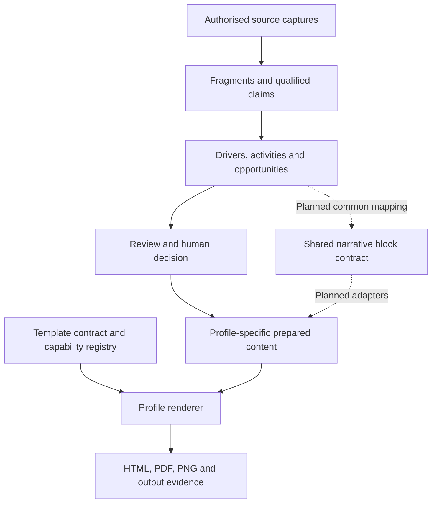

# Evidence to decision to publication

The repository separates research, analytical judgement, editorial binding and output evidence. The [domain model](domain-and-data.md) defines the objects; [workflow](../../skills/hivest-portfolio-ai/references/workflow.md) defines business stages; [code map](code-map.md) identifies executable components.

## Data moves through explicit contracts

This is a macro data-flow view. Solid arrows represent the existing workflow's handoffs, several of which are human/agent-assisted. Dashed arrows identify the planned common narrative adapter.

**Extract:** acquisition records the original source, rights, exact capture scope and bytes outside public Git. Fragments and claims retain locators, dates, company/sector scope, contradictions and unknowns. [Dictionary](../data/DATA_DICTIONARY.md) and [hash rules](../../contracts/HASHING.md) define the fields and integrity scopes.

**Transform:** market signal → company exposure → economic driver → activity/opportunity → baseline and prerequisites → three review perspectives. The [business rule matrix](rules-and-validation.md) connects checks to tests. Company exposure can remain a hypothesis; a sector signal does not prove local deployment.

**Publish:** select a supported [binding/profile](template-binding.md), prepare its content and render it. Final content requires the applicable GO_DRAFT and freeze; demonstration paths remain labelled and separate. Output evidence records actual file hashes, physical pages, automated layout and reader-review state. The [publication preflight](../agent/publication-preflight.md) leaves authenticated human release with the responsible authority.

## State and context management span the workflow

[Programme state](../../program/state.json), company manifests and review evidence determine which stage can proceed. The [context protocol](../agent/context-and-resume.md) bounds the next question and pins versions/bytes. The graph computes dependencies and affected descendants; integrating revised evidence and advancing states remain deliberate operations.

The [handoff contract](../agent/handoff-and-fallback.md) declares the required capabilities of a receiving session. It distinguishes metadata validation from independently observed access. The resume CLI is implemented; acceptance of actual cross-model transfer remains open.

## Data and build have distinct authorities

| Concern | Authority | Dependency / consumer |
| --- | --- | --- |
| Company evidence and analytical meaning | Company package, context and their reviewed sources | Diagnostic procedure and editorial selection |
| Company/programme phase | State, manifest and corresponding gate evidence | Router and human/integrating operator |
| Data shape and bounded invariants | Schemas and validators | Fixtures, tests and CLI checks |
| Template availability and input shape | Registry + profile schema/template | Profile renderer |
| Layout and output bytes | Renderer/CSS, actual artifacts, manifest and QA | Reader review, artifact receipt and publication workflow |
| Historical rationale | [Decision register](README.md) | Current architecture and successor decisions |

## Workstreams and extension limits

The company programme, the [fund strategic note](../../companies/hivest/INDEX.md) and the [learning pilot](../../learning/enterprise-ai/README.md) own separate inputs and acceptance loops. Their reusable helpers do not transfer company gates between workstreams.

Implemented profiles have their own payload/binding rules and QA. The common narrative contract, side-story lifecycle and full block→claim→fragment→source coverage across formats remain planned work. Portfolio rollup, client parameterisation, source adapters and reproducible runtime locks have outstanding acceptance gaps tracked in the [industrialisation roadmap](../roadmap/industrialization-backlog.md) and [live issues](https://github.com/achard-arnaud/Business-ptf-analysis/issues).

## Learning and history

A completed review feeds defect → cause → proposed rule → contract/test → human promotion. The [historical Sphere loopback](LOOPBACK_SPHERE_V03.md) records an early iteration. Programme promotion still requires both pilots and their loopback, as defined by the current state and [gates](../agent/gates.md).
